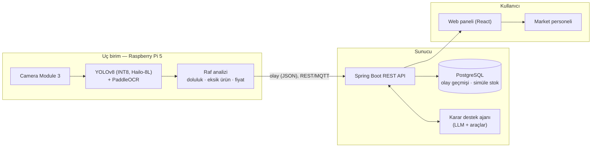
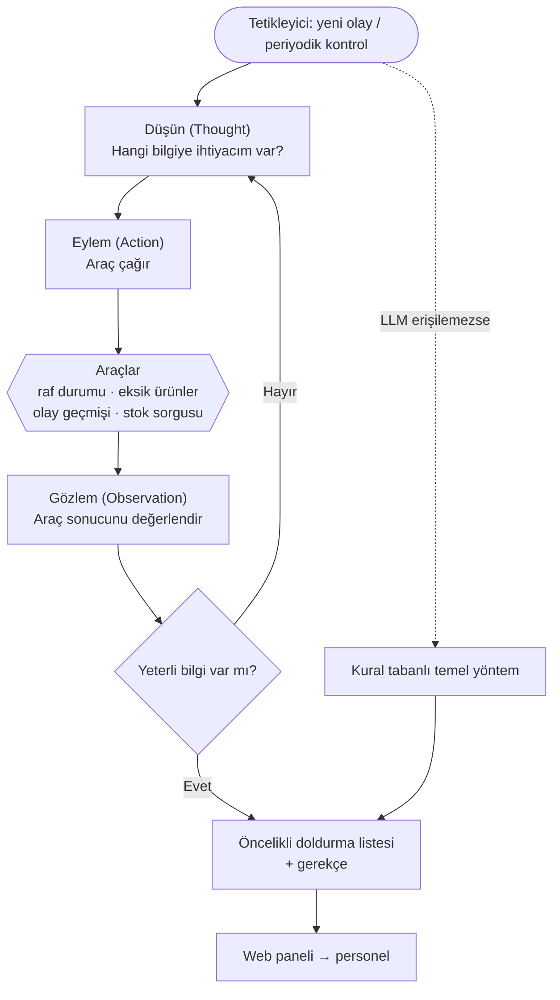

# Edge-AI and Agentic Computer Vision Based Intelligent Retail Shelf Monitoring and Decision Support System

**Uç Birimde Yapay Zekâ ve Ajan Tabanlı Bilgisayarlı Görü ile Akıllı Market Rafı İzleme ve Karar Destek Sistemi**

Bilgisayar Mühendisliği bitirme projesi · İstanbul Rumeli Üniversitesi · 2026–2027

> **English summary.** A low-cost edge device (Raspberry Pi 5 + AI HAT+ with Hailo-8L NPU + Camera Module 3) placed in front of a retail shelf will detect empty shelf space, missing products and price tags in real time, and read the price tags with OCR, without sending images to the cloud. Only event data (JSON) is sent to a Spring Boot backend. An LLM-based ReAct agent on top of this data will suggest a prioritized, justified restocking list to store staff through a web dashboard. **Current status:** the Pi 5 is set up, the AI HAT+ is recognized, and live detection with the stock pre-trained YOLOv8 model runs at ~30 FPS (limited by the camera frame rate). Everything else is planned.

---

## Proje tanımı

Marketlerde raf kontrolü çoğunlukla personelin gözle dolaşmasıyla yapılır; boş raf geç fark edilir, hangi rafın önce doldurulacağına sezgiyle karar verilir ve etiketteki yanlış fiyat müşteri güvenini zedeler. Bulut tabanlı kamera çözümleri ise bant genişliği ve gizlilik sorunu yaratır.

Bu projede rafın önüne konan bir uç cihazın, görüntüyü buluta göndermeden:

- **Boş raf analizi** — raf bölgesi başına doluluk oranı, eşik aşılınca uyarı,
- **Eksik ürün tespiti** — fiyat etiketinin üstü boşsa etiketteki ürün adıyla bildirim,
- **Fiyat etiketi okuma (OCR)** — ürün adı ve fiyat; simüle fiyat listesiyle karşılaştırıp yanlış fiyat uyarısı

yapması, LLM tabanlı bir **karar destek ajanının (ReAct)** da bu veriden personele **öncelikli, gerekçeli doldurma listesi** önermesi hedeflenmektedir. Sonuçlar bir web panelinde gösterilecektir.

## Donanım

| Kalem | Kullanım amacı |
|---|---|
| Raspberry Pi 5 (8 GB) | Uç birim ana bilgisayarı |
| Raspberry Pi AI HAT+ (Hailo-8L, 13 TOPS) | Nesne tespiti için NPU hızlandırıcı |
| Raspberry Pi Camera Module 3 (12 MP) | Raf görüntüsü |
| Aktif soğutucu, kasa, 27 W adaptör, 128 GB microSD | Kesintisiz çalışma |
| 5" dokunmatik ekran | Cihaz üzerinde izleme ve demo |

## Sistem mimarisi

Görüntü işleme tamamen raf önündeki cihazda yapılır; sunucuya yalnızca olay verisi (JSON) gider, ham görüntü cihazdan çıkmaz.

| Klasör | İçerik |
|---|---|
| [`edge/`](edge/) | Uç birim yazılımı (Pi 5 + AI HAT+) |
| [`backend/`](backend/) | Spring Boot API ve veritabanı |
| [`agent/`](agent/) | LLM tabanlı karar destek ajanı |
| [`web/`](web/) | React web paneli |
| [`docs/`](docs/) | Proje raporu ve belgeler |

## Ajan döngüsü (ReAct)

## Mevcut durum

- [x] Raspberry Pi 5 kuruldu.
- [x] AI HAT+ (Hailo-8L) sistem tarafından tanındı.
- [x] Hailo'nun **hazır (önceden eğitilmiş) YOLOv8 modeliyle** canlı tespit çalıştırıldı — komut: [`edge/run_demo.sh`](edge/run_demo.sh).
- [x] Bu demoda **~30 FPS** gözlendi. Bu değer kameranın kendi kare hızıdır; darboğaz NPU değil kameradır.

> Not: Bu demo genel amaçlı (COCO) hazır modeldir. Projeye özel model (ürün / boş alan / fiyat etiketi), OCR, raf analizi, back-end, ajan ve web paneli henüz geliştirilmemiştir.

## Yol haritası

| İş paketi | Kapsam | Hedef tarih | Durum |
|---|---|---|---|
| İP0 Analiz ve planlama | Literatür taraması, gereksinimler, mimari, plan onayı | 6 Kasım 2026 | Planlanan |
| İP1 Veri seti | SKU-110K hazırlığı; maket rafta 300+ görüntü; ürün / boş alan / fiyat etiketi etiketleme | 6 Aralık 2026 | Planlanan |
| İP2 Model eğitimi ve derleme | YOLOv8n/s eğitimi ve karşılaştırması; ONNX → INT8 → Hailo HEF | 10 Ocak 2027 | Planlanan |
| İP3 Uç birim yazılımı | Kamera + çıkarım döngüsü, etiket kırpma + OCR, ROI doluluk, olay üretimi, çevrimdışı kuyruk | 15 Ocak 2027 | Planlanan |
| İP4 Back-end | Spring Boot REST API, PostgreSQL şeması, olay kaydı, uyarı servisi | 14 Mart 2027 | Planlanan |
| İP5 Karar destek ajanı | ReAct ajanı, araçlar, simüle stok, kural tabanlı temel yöntem | 25 Nisan 2027 | Planlanan |
| İP6 Web paneli | Raf durumu, uyarılar, öneri ekranı, ROI tanımlama | 25 Nisan 2027 | Planlanan |
| İP7 Entegrasyon ve test | Uçtan uca entegrasyon, maket raf testleri, performans deneyleri | 16 Mayıs 2027 | Planlanan |
| İP8 Tez ve sunum | Tez, poster, final sunumu, demo videosu | Haziran 2027 başı | Planlanan |

**Planlanan ek katkılar:** CPU-FP32 / CPU-INT8 / NPU-INT8 karşılaştırmalı doğruluk–hız–güç deneyi; OCR ile okunan fiyatın simüle fiyat listesiyle karşılaştırılıp yanlış fiyat uyarısı.

**Hedef başarı ölçütleri (planlanan):** boş alan tespiti mAP@0.5 ≥ 0,80 · fiyat etiketi tespiti mAP@0.5 ≥ 0,85 · fiyat okuma doğruluğu ≥ %90 · uç cihazda ≥ 15 FPS · INT8 kuantizasyon kaybı ≤ 3 puan mAP · raf boşalmasından panelde uyarıya ≤ 60 sn.

Ayrıntılar için: [`docs/`](docs/)
